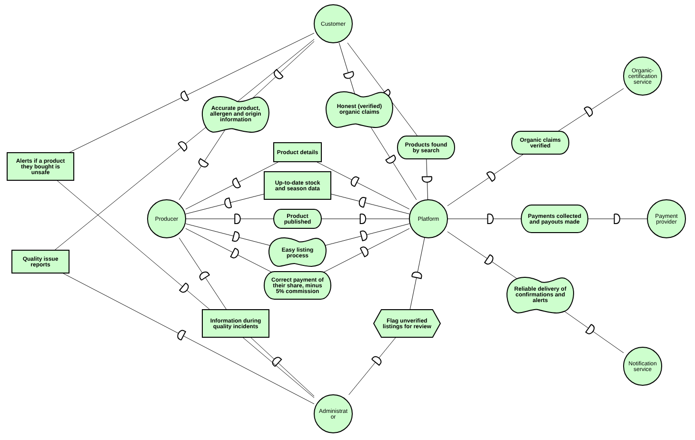
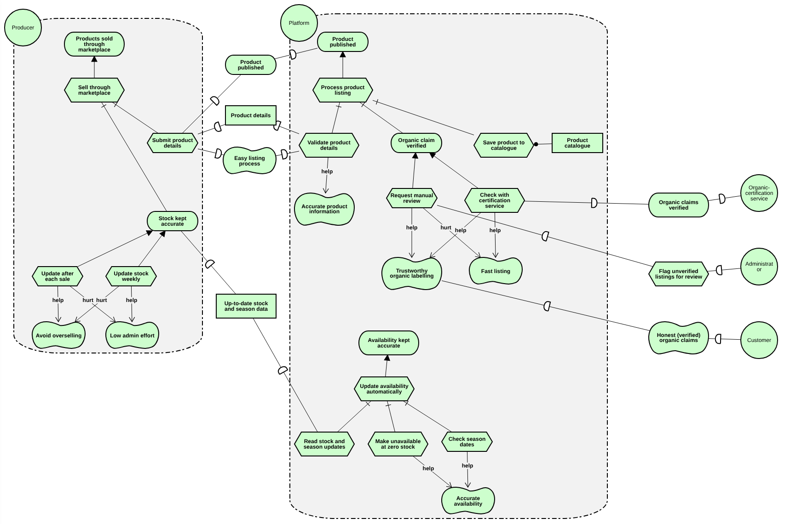

# i* models (Sprint 2)

Owner: Mohamed Alabweh (Member 2). Backlog item: E3-03.

| File | What it is |
|---|---|
| `sd-model.txt` / `sd-model.png` | Strategic Dependency (SD) model: 7 actors and 15 dependencies, taken from section 3.3 of [case-study-analysis.md](../../docs/case-study-analysis.md). |
| `sr-model.txt` / `sr-model.png` | Strategic Rationale (SR) model for Use Case 1: the internal reasoning of the Platform and the Producer, with alternatives and help/hurt trade-offs from section 3.4. |

The `.txt` files are piStar models (iStar 2.0). Open them at https://www.cin.ufpe.br/~jhcp/pistar/ with the tool's load option. The `.png` files are exports.

In iStar 2.0, softgoals are called **qualities** (cloud shapes).

## Strategic Dependency (SD) model

**Actors.** The seven actors from section 3.1: Producer, Customer, Platform, Administrator, and three external services (organic certification, payment, notifications). The marketplace is split into **Platform** (automated work) and **Administrator** (human judgement), matching the two lanes in the strategic BPMN.

**Dependencies.** Every dependency comes from the table in section 3.3 and uses the same name. Each is read as *depender → dependum → dependee*, and uses one of the four iStar types:

| Type | Example from the model |
|---|---|
| Goal | Producer depends on Platform for *Product published* |
| Quality | Customer depends on Platform for *Honest (verified) organic claims* |
| Task | Administrator depends on Platform to *Flag unverified listings for review* |
| Resource | Platform depends on Producer for *Product details* |

**What it shows.** The Platform is the hub: almost every actor depends on it, and it depends on the three external services. The busiest pair is **Producer ↔ Platform**, which is Use Case 1: the platform needs product details and stock data, and the producer needs its products published through an easy listing process.

## Strategic Rationale (SR) model

**Scope.** The SR model opens up the two actors that own Use Case 1, the **Platform** and the **Producer**. The other actors stay collapsed and connect through the same dependencies as the SD model.

**Platform.** Two top-level goals, one per functionality:

- **Product published** (Functionality 1) is achieved by *Process product listing*, which needs all of: *Validate product details*, *Organic claim verified* and *Save product to catalogue*.
- **Availability kept accurate** (Functionality 2) is achieved by *Update availability automatically*, which reads stock and season updates, makes products unavailable at zero stock, and checks season dates.

**Producer.** The goal **Products sold through marketplace** is achieved by selling through the marketplace: submitting product details and keeping stock accurate.

**Trade-offs** (from the tensions in section 3.4):

| Choice | Helps | Hurts | Tension |
|---|---|---|---|
| *Check with certification service* | Trustworthy organic labelling, Fast listing | – | Normal path for organic claims |
| *Request manual review* (service unavailable) | Trustworthy organic labelling | Fast listing | Waiting protects trust but delays sales (BR-02, BR-03) |
| *Update after each sale* | Avoid overselling | Low admin effort | Producers also sell offline, so stock drifts (BR-04) |
| *Update stock weekly* | Low admin effort | Avoid overselling | Same tension, opposite choice |

These show why the design never publishes an unverified organic claim, and why availability is updated automatically at zero stock instead of relying on producers alone.

## Traceability to the BPMN

The SR goals and tasks match the strategic BPMN and will match the operational BPMN (backlog item E3-06):

| i* element (SR) | Strategic BPMN sub-process |
|---|---|
| *Product published* / *Process product listing* | Manage product listings |
| *Availability kept accurate* / *Update availability automatically* | Manage inventory and availability |
| *Check with certification service* | Message flows to the Organic Certification Service |
| *Request manual review* | Administrator lane |
